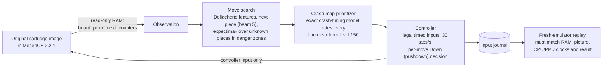

# Tetris bots: original NES Tetris to level 255, and a modern-rules offline sprint

[](LICENSE)


Two Tetris-playing bots, each judged only by results that are replayed and verified:

1. **NES Tetris (current work).** A bot plays Nintendo's original Tetris (USA, NTSC, A-Type)
   in the MesenCE emulator from level 18, through the real menus, with **controller input
   only** — no ROM, RAM or random-number edits and no savestates in play — and reaches
   level 255, past the game's level-155+ crash bugs.
2. **Offline Sprint (earlier work).** A self-contained modern-rules game with a learned
   (Double DQN) board-scoring policy, reachable-move planning and a lookahead study.

## Headline results

**Original NES cartridge, MesenCE 2.2.1, from level 18** — full list in
[nes-bot/docs/RESULTS-255.md](nes-bot/docs/RESULTS-255.md):

| Result | Verified games | Detail |
|---|---|---|
| Reached level 255 | **20** | 3,290 lines each; uncapped score 22.13–22.53 million (mean 22,353,715). The cartridge's own counter stops at 999,999. |
| Rebirth: level 255 → wrap to 0 → level 255 again | **1** | Absolute level 511, 6,651 lines, uncapped score 43,047,996 (bot v8b, seed 19211). |
| Current bot (v8c) | 6 of 7 | development games reached 255; the crash-zone simulator estimates about 94–95% per game (simulator estimate, not a verified rate). |

**Offline Sprint v1** (this project's own modern ruleset) — details in
[modern-rules/docs/OFFLINE-SPRINT.md](modern-rules/docs/OFFLINE-SPRINT.md):

- **20/20** reserved 40-line games passed (target was 18/20), each verified by replaying only
  its frame-numbered inputs; zero rejected inputs, board mismatches or planning overruns.
- One-move lookahead (beam 4) survived the 5,000-placement cap in **15/15** matched
  model/stream cases versus **10/15** without it (censored outcomes, not averages).
- One endurance game reached **15,464 lines** and was still alive at its wall-time cutoff
  (a single unfinished game, not an average).
- **NES bot on modern rules (2026-10-26).** The NES bot's evaluator and beam search, ported to
  this game (`modern-rules/offline/classic_bot.py`), also passed **20/20** of the same 40-line
  games, input-replay verified, using fewer pieces (~101 vs ~108). On endurance, both bots were
  still alive at a 5,000-line cap on 8 seeds and at **50,000 lines** on seed 92000. This ruleset
  doesn't separate them on survival. Details in the write-up.

## How the NES bot works



- **Why it is hard.** From level 29 pieces fall one row per frame. From level 155, a line
  clear can make the score routine overrun into the frame interrupt and crash the CPU;
  whether it does depends on the level, line count, which rows clear, soft-drop points and
  a little unobservable timing. Danger zones are roughly levels 154–173 and 247–255.
- **Crash avoidance** uses `nes-bot/nes_original/crash_cycle_model.py`, a Python port of
  HydrantDude's crash-timing model as implemented in TetrisGYM, validated on 986 of 988
  community sheet cells and on the crashes observed in real runs. The bot plays the
  safest surviving move, decides per move whether to hold Down, and accepts some risk only
  when the stack is high enough that a top-out is the bigger danger.
- **Not reinforcement learning.** The level-255 bot is a search over a hand-designed
  evaluator whose weights were tuned on a simulator. The learned (DQN) policies in this
  repository belong to the Offline Sprint and the earlier NES learning pilots.

Full explanation: [nes-bot/docs/NES-255.md](nes-bot/docs/NES-255.md).

## Verification

Every NES result above was produced from controller input only and then replayed from its
recorded inputs in a **fresh** MesenCE process; a game counts only when RAM, the picture,
CPU/PPU clocks and the final result match exactly (`case_state: verified`). Seeds are the
number of frames waited on the menu, which fixes the piece sequence. Offline Sprint results
are likewise verified by replaying their primitive inputs against the engine.

## Quick start

Windows, Python 3.13. The repository includes small trained policies; no training is needed
to play.

**Offline Sprint** (installs `.venv`, pinned CPU dependencies, and runs the tests):

```powershell
.\modern-rules\setup.ps1
.\modern-rules\play.ps1            # watch the bot
.\modern-rules\play.ps1 -Human     # play yourself
.\modern-rules\evaluate.ps1        # reproduce the 20-seed acceptance evaluation
```

**NES level-255 bot.** Needs a portable
[MesenCE 2.2.1](https://github.com/nesdev-org/MesenCE/releases/tag/2.2.1) and the original
USA game image already installed by the `gym-tetris` dependency (no game image is included
in this repository). Set up the isolated environment as described in
[nes-bot/docs/NES-ORIGINAL-REFERENCE.md](nes-bot/docs/NES-ORIGINAL-REFERENCE.md) (`.\nes-bot\setup-nes-original.ps1`,
plus `nes-bot/requirements-nes-search.txt` for the compiled planner), then point the launcher at it
with the `MESEN`, `PY` and `JIT_DEPS` variables:

```bash
sh nes-bot/tools/run255.sh 19211            # one game to level 255, then replay verification
sh nes-bot/tools/run255.sh 19211 511        # rebirth: back up to level 255 on the second lap
sh nes-bot/tools/run255.sh 19211 endless    # until the bot tops out or crashes
nes-bot\tools\watch.cmd 500                 # watch a recorded game with an uncapped-score panel
```

Test changes cheaply with the crash-zone simulator `nes-bot/tools/zone_sim.py` (see
[nes-bot/tools/README.md](nes-bot/tools/README.md)).

**Tests:**

```powershell
.\.venv\Scripts\python.exe -m pytest -q        # from the repository root: all three bots
```

`pytest.ini` puts all three bot folders on the import path, so no install is needed for tests.
Emulator-dependent tests skip when MesenCE or optional dependencies are not available.

`nes-bot/tests/test_sim_regression.py` (needs numpy + numba) pins the simulators: seeded games, v8c
crash-zone games, 1G reach limits and the crash model must match `nes-bot/tests/data/sim_golden.json`,
and survival floors must hold. After an intended behaviour change, check the floors (full
v8c baseline: `SIM_FULL_BASELINE=1`, about 10 minutes on 4 cores), then re-record with
`python nes-bot/tools/sim_golden.py --write`.

## Project layout

Each bot has its own top-level folder with its code, tests, docs, evidence and setup files.

| Folder | What it is |
|---|---|
| [`nes-bot/`](nes-bot/README.md) | **Current work.** The original-NES bot (level 255, score, rebirths): `nes_original/` (MesenCE adapter, planner, crash model, endurance runner, replay), `nes/` (the NES rules engine it builds on, plus the early NES learning pilot), `tools/` (launchers, batch runner, crash-zone simulator, tuners), `tests/`, `docs/`, `evidence/`. |
| [`modern-rules/`](modern-rules/README.md) | The Offline Sprint: this project's own modern-rules game (`offline/`: 7-bag, hold, SRS, lock delay) and its bot controller, acceptance evaluator and endurance runner. |
| [`old-dqn/`](old-dqn/README.md) | The learned bots: Double DQN board evaluator (`dqn/`), the original Stable-Baselines3 placement wrapper (`tetris_macro_env.py`), trained policies (`models/`), playback and GIF scripts. |
| [`docs/`](docs/README.md) | Index of every document. |
| [`progress.md`](progress.md) | Dated development log (kept at the root; some scripts update it). |

**Imports.** Each bot folder is an import root (`import nes_original`, `import offline`,
`import dqn`), and the bots share code: the modern-rules bot uses the DQN evaluator in
`old-dqn/`. The launchers and `pytest.ini` set the path themselves. To run `python -m ...`
commands by hand, either run once per Python environment, from the repository root:

```bash
python -m pip install -e .
```

or set `PYTHONPATH` to the folders you need (for example `PYTHONPATH=nes-bot` for the NES bot).
Run commands from the repository root; output goes to `runs/` there.

## Contributing

New work follows [CONTRIBUTING.md](CONTRIBUTING.md): where files go in the folder layout,
branch names (`<area>/<short-topic>`), one goal per PR with the
[PR template](.github/pull_request_template.md), merge commits on GitHub, and which README
or results file to update in the same PR.

## Limits

- Results are verified **in an emulator (MesenCE 2.2.1), not on NES hardware**.
- About 5% of games still fail by the simulator estimate, mostly around level 157, where every
  single carries at least 25% crash risk.
- The crash model's predictions beyond the first lap are tested only by the one rebirth game.
- The bot scores mostly with singles; tetris-building at level-29 speed is not yet safe.
- The ~94–95% per-game rate is a simulator estimate; verified counts are the ones in the
  results table.
- Offline Sprint uses this project's own ruleset; it is not an official Tetris product or a
  Guideline certification, and its results say nothing about NES play.

## Credits and references

- **HydrantDude**'s crash research ("Crash Theory" sheet) and its in-game implementation in
  [TetrisGYM](https://github.com/kirjavascript/TetrisGYM) (`src/modes/crash.asm`) — the basis
  of the crash-timing model.
- [MesenCE](https://github.com/nesdev-org/MesenCE) — the reference emulator.
- [CelestialAmber/TetrisNESDisasm](https://github.com/CelestialAmber/TetrisNESDisasm),
  [MeatFighter's NES Tetris analysis](https://meatfighter.com/nintendotetrisai/) and
  [negative-seven's "Tetris explained"](https://negative-seven.github.io/tetris_explained/#high-levels--crashing-the-game)
  — game mechanics and crash behaviour.
- [nes-py](https://github.com/Kautenja/nes-py) and [gym-tetris](https://github.com/Kautenja/gym-tetris)
  — the alternative emulator core and the installed game image.
- Rotation conventions were checked against [Cold Clear](https://github.com/MinusKelvin/cold-clear/blob/master/libtetris/src/piece.rs);
  the offline engine and controller were implemented independently.
- Board features follow Dellacherie's classic evaluator; research context:
  [Gabillon, Ghavamzadeh & Scherrer (2013)](https://mohammadghavamzadeh.github.io/PUBLICATIONS/nips13-tetris.pdf).
  Their rules and scores are not interchangeable with this project's tests.

Tetris is a trademark of The Tetris Company. This is an independent research project, not
affiliated with or endorsed by Nintendo or The Tetris Company.

## License

Project code is MIT — see [LICENSE](LICENSE). Dependencies keep their own licenses.
